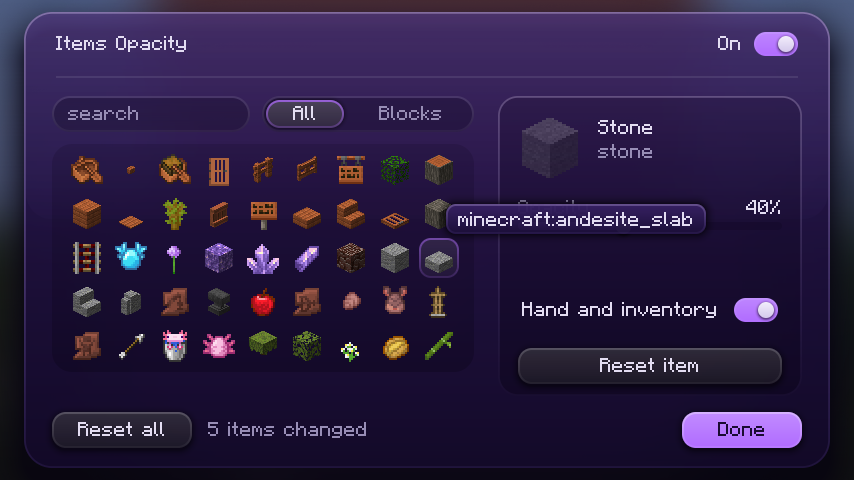
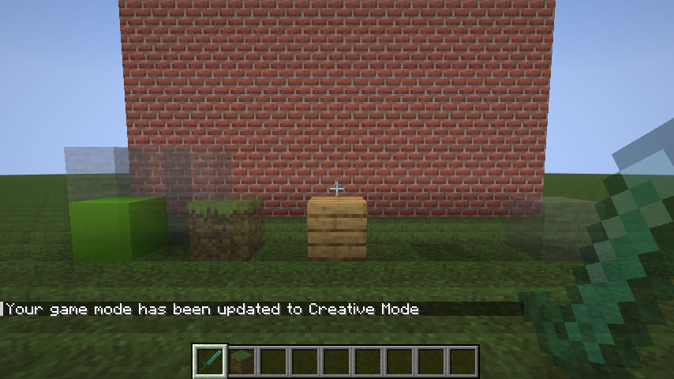

# Items Opacity

pick any block or item and change its opacity from 100% down to 0%. client side fabric mod for 1.21.11, needs fabric api and [Wysss Library](https://github.com/realwysss/Wysss-Library). press **M**.

- works with every block (also with sodium) and every item
- 0% is invisible, the menu warns you about it
- one switch for the whole mod and one for items in your hand and inventory
- search and block filter in the menu

## download

| jar | minecraft |
|---|---|
| `items-opacity-mc1.21.11-1.0.0.jar` | 1.21.11 |

on the releases page.

## pictures

## license

all rights reserved, made by wysss.
